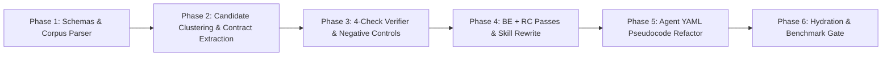

# Skill-as-Pseudocode (SaP) Architecture & Migration Plan

Reference: *Skill-as-Pseudocode: Refactoring Skill Libraries to Pseudocode for LLM Agents* (Li et al., arXiv:2605.27955v2)

---

## 1. Architectural Diagnosis (`Location | Problem | Fix`)

| Location | Problem | Fix |
| :--- | :--- | :--- |
| [`.agent/skills/*/SKILL.md`](file:///mnt/d/OneDrive/Email_attachments/Programming-Work/.agent/skills/skill-kubernetes/SKILL.md#L1-L58) (55 skills, 140 [`references/*.md`](file:///mnt/d/OneDrive/Email_attachments/Programming-Work/.agent/skills/skill-kubernetes/SKILL.md#L14-L16)) | Prose-interleaved instructions force runtime derivation of input schema and CLI syntax on every retrieval ("confused -> re-retrieve" loop). | Convert procedural sections into **Substituted SaP Bundles**: `[1] Action Templates` -> `[2] Rewritten Skeleton (invoke(κ, args))` -> `[3] Inlined Typed Contracts (κ)`. |
| [`.agent/agents/*.yaml`](file:///mnt/d/OneDrive/Email_attachments/Programming-Work/.agent/agents/specialist-k8s.yaml#L1-L46) (16 canonical agents) & [`agent.schema.json`](file:///mnt/d/OneDrive/Email_attachments/Programming-Work/.agent/adapters/schemas/agent.schema.json#L1-L25) | `prompt` field contains narrative persona paragraphs and untyped workflow lists; `returns` is untyped string. | Extend [`agent.schema.json`](file:///mnt/d/OneDrive/Email_attachments/Programming-Work/.agent/adapters/schemas/agent.schema.json#L9-L24) with optional `contract` (`trigger`, `input_schema`, `output_schema`, `preconditions`, `postconditions`, `side_effects`) and rewrite `prompt` into typed pseudocode dispatch tables. |
| [`scripts/hydrate.py`](file:///mnt/d/OneDrive/Email_attachments/Programming-Work/scripts/hydrate.py#L66-L84) ([`hydrate_skills`](file:///mnt/d/OneDrive/Email_attachments/Programming-Work/scripts/hydrate.py#L66)) | [`hydrate_skills`](file:///mnt/d/OneDrive/Email_attachments/Programming-Work/scripts/hydrate.py#L66) symlinks raw `.agent/skills/*` directly into `.claude/skills` and `.agents/skills` without contract substitution or child isolation. | Store extracted child contracts in internal store `.agent/contracts/*.yaml` (hierarchical separation; exposing child contracts top-level drops reward 27%). Render substituted bundles into `.claude/skills/*/SKILL.md` and `.agents/skills/*/SKILL.md` during [`hydrate.sh`](file:///mnt/d/OneDrive/Email_attachments/Programming-Work/scripts/hydrate.sh#L1-L16). |
| [`bin/verify_runtime_discovery.py`](file:///mnt/d/OneDrive/Email_attachments/Programming-Work/bin/verify_runtime_discovery.py) | Verifies schema presence and symlink parity only; lacks SaP 4-check deterministic verification over skill procedures. | Add `scripts/sap/` implementing Stage 1-5 + 4-check deterministic verifier (`Coverage`, `Binding`, `Replacement`, `Risk`) and post-checks for Binding Extraction (BE) and Rewrite Cleanup (RC). |

---

## 2. Core SaP Design Laws Mapped to `.agent/` Governance

1. **Action Templates + Contract Pairing (SaP §5.7 Table 4)**:
   - Serving a typed contract without concrete action templates drops task reward below raw prose (`13/134` vs `16/134` wins; full bundle achieves `30/134`).
   - Every refactored `SKILL.md` and `references/*.md` MUST place concrete executable CLI/API templates in Block 1 (prefix region read first), followed by the `invoke(κ, bindings)` procedural skeleton in Block 2, and inlined typed contracts in Block 3.
2. **Hierarchical-Only Retrieval Pool (SaP §3.5, §5.6)**:
   - Shared sub-procedures across parent skills (`k8s-context-guard`, `rtk-shell-pipe`, `ast-blast-radius-gate`, `gopass-secret-fetch`, `git-feature-branch-gate`) reside in `.agent/contracts/<contract-id>.yaml`.
   - Child contracts are never exposed as standalone top-level skills in `.agent/skills/` or `.agent/metadata.json` `skills[]` list, preventing uncontextualized retrieval without parent action templates.
3. **Physical Sovereignty & Ephemeral Projection (`AGENTS.md` §0.2, §5 Rule 5)**:
   - `.agent/` is the single physical source-of-truth directory; `.claude/`, `.agents/`, and `.codex/` are generated projections.
   - Redundant or thin wrapper skills inside `.agent/skills/` can be consolidated directly into parent skill `references/*.md`, `scripts/`, or `.agent/contracts/*.yaml`.
4. **Static vs Runtime Binding Boundary (SaP §3.5)**:
   - Index-time bindings supply environment constants and default flags; dynamic episode values use explicit `{slot}` placeholders paired with observation-refresh preconditions.

---

## 3. Target Schemas & Representation Format

### A. Child Contract IR Schema (`.agent/adapters/schemas/contract.schema.json` -> `.agent/contracts/<id>.yaml`)

Maps directly to SaP Appendix H:

```yaml
id: k8s-pod-triage
trigger: "Pod status in {Pending, CrashLoopBackOff, Error, ImagePullBackOff, Evicted}"
input_schema:
  required:
    namespace: string
    pod_name: string
  optional:
    container_name: string
    manifest_path: path
output_schema:
  root_cause_category: "enum[ImagePull, CrashLoop, OOMKilled, Scheduling, Network, Probe]"
  evidence_log_span: string
  remediation_cmd: string
preconditions:
  - "kubectl context authenticated and non-prod verified (or --allow-prod-read)"
postconditions:
  - "Failure isolated to container, scheduler, or registry before mutation"
resources:
  - "{SKILL_DIR}/references/PodCrashLoopBackOff.md"
side_effects:
  filesystem: none
  network: "read-only K8s API GET/LIST (pods, pods/log, events)"
source_parents:
  - skill-kubernetes
  - skill-sre-investigation
  - skill-gcp-playbooks
action_templates:
  - "kubectl get pods -n {namespace} | bin/rtk"
  - "kubectl logs {pod_name} -n {namespace} -c {container_name} --tail=100 | bin/rtk"
  - "kubectl describe pod {pod_name} -n {namespace} | bin/rtk"
verifier_stats:
  coverage: 0.92
  binding: 0.88
  replacement: 1.00
  risk: 0.00
  promotion_score: 0.91
  tier: auto_promote
```

### B. Agent-Facing Substituted `SKILL.md` Bundle Layout (SaP §3.5 Figure 2)

Target structure for [`.agent/skills/skill-kubernetes/SKILL.md`](file:///mnt/d/OneDrive/Email_attachments/Programming-Work/.agent/skills/skill-kubernetes/SKILL.md#L1-L58):

````markdown
---
name: skill-kubernetes
description: Deep-dive K8s operator for managing GKE/EKS clusters and troubleshooting containerized workloads.
---
# Skill: skill-kubernetes (SaP Bundle)
> NOTE: `invoke(...)` is structural pseudocode notation in this skill document, not a shell binary. Execute the concrete Action Templates mapped to each `invoke` binding.

## 1. Action Templates (Concrete How — Read First)
```bash
# [κ: k8s-reference-index] bindings: skill_dir="{SKILL_DIR}/references"
ls {skill_dir} | bin/rtk

# [κ: k8s-pod-triage] bindings: namespace="<ns>", pod_name="<pod>", container_name="<container>"
kubectl get pods -n {namespace} | bin/rtk
kubectl logs {pod_name} -n {namespace} -c {container_name} --tail=100 | bin/rtk
kubectl describe pod {pod_name} -n {namespace} | bin/rtk

# [κ: k8s-net-verify] bindings: pod_name="<pod>", namespace="<ns>", service_name="<svc>"
kubectl exec -it {pod_name} -n {namespace} -- nslookup {service_name}.{namespace}.svc.cluster.local | bin/rtk

# [κ: k8s-workload-recover] bindings: deployment_name="<deploy>", namespace="<ns>"
kubectl rollout restart deployment {deployment_name} -n {namespace} | bin/rtk
```

## 2. Procedural Skeleton (Where Calls Fit)
```text
PROCEDURE diagnose_and_remediate(namespace, pod_name, deployment_name):
  1. ref_doc <- invoke(k8s-reference-index, {skill_dir: "{SKILL_DIR}/references", symptom: symptom})
  2. diag    <- invoke(k8s-pod-triage, {namespace: namespace, pod_name: pod_name, container_name: "*"})
  3. IF diag.root_cause_category == "Network":
       net_state <- invoke(k8s-net-verify, {pod_name: pod_name, namespace: namespace, service_name: target_svc})
  4. IF diag.root_cause_category == "Evicted":
       PATCH Helm values resources.requests / resources.limits
  5. IF diag.root_cause_category == "Transient":
       invoke(k8s-workload-recover, {deployment_name: deployment_name, namespace: namespace})
  6. RETURN {Location, Problem: diag.root_cause_category, Fix: diag.remediation_cmd}
```

## 3. Inlined Child Contracts (Abstract Guarantees)
- **`κ: k8s-pod-triage`**
  - `trigger`: Pod status in `{Pending, CrashLoopBackOff, Error, ImagePullBackOff}`
  - `inputs`: `namespace: str`, `pod_name: str`, `container_name?: str`
  - `output`: `{root_cause_category, evidence_log_span, remediation_cmd}`
  - `pre`: K8s context verified | `post`: Root cause isolated prior to mutation | `side_effects`: read-only K8s API
- **`κ: k8s-net-verify`**
  - `trigger`: Service discovery or mTLS failure between pods
  - `inputs`: `pod_name: str`, `namespace: str`, `service_name: str`
  - `output`: `{dns_resolved: bool, mtls_peer_auth_mode: str}`
  - `pre`: Target pod running | `post`: DNS and PeerAuthentication state captured | `side_effects`: exec in pod
- **`κ: k8s-workload-recover`**
  - `trigger`: Transient pod failure after root cause isolation
  - `inputs`: `deployment_name: str`, `namespace: str`
  - `output`: `{rollout_status: str}`
  - `pre`: `diag.root_cause_category == "Transient"` | `post`: Deployment rolling restart triggered | `side_effects`: mutates K8s Deployment pod template annotation
````

### C. Canonical Agent YAML Structure (`.agent/agents/<name>.yaml`)

Target structure for [`.agent/agents/specialist-k8s.yaml`](file:///mnt/d/OneDrive/Email_attachments/Programming-Work/.agent/agents/specialist-k8s.yaml#L1-L46):

````yaml
version: '2.2'
name: specialist-k8s
description: 'Domain Specialist Subagent. Use for: Kubernetes orchestration, Helm charts, ArgoCD, Crossplane, and k9s.'
role: worker
tier: fast
capabilities:
  - read
  - search
  - shell
skills:
  - skill-kubernetes
  - skill-aws-foundation
  - skill-observability
  - skill-conductor
contract:
  trigger: "Task targets Kubernetes manifests, Helm charts, ArgoCD apps, Crossplane XRDs/Compositions, or live cluster triage"
  input_schema:
    required:
      task_spec: string
      target_scope: "enum[manifests_only, live_cluster, helm_chart, crossplane]"
    optional:
      namespace: string
      kubeconfig_context: string
  output_schema:
    findings: "list[{Location, Problem, Fix}]"
    evidence_boundary: "enum[static_ast, manifests_only, live_cluster]"
  preconditions:
    - "All shell commands piped through bin/rtk"
    - "Non-production context verified prior to cluster reads"
  postconditions:
    - "Declarative state preserved (Helm/Kustomize/Crossplane)"
    - "Resource requests/limits and rolling update strategy verified"
  side_effects:
    filesystem: "read-only unless :code or :change mode active"
    network: "read-only kubectl queries unless explicit rollout/apply approved"
prompt: |
  # Specialist: specialist-k8s (SaP Contract Agent)
  > NOTE: `invoke(...)` is structural notation. Execute concrete Action Templates from bound skills.

  ## 1. Action Templates (Concrete How)
  ```bash
  # Live cluster / CRD Graphify extraction
  /usr/bin/python3 .agent/skills/skill-graphify/scripts/k8s_graphify_extract.py -n {namespace} | bin/rtk
  # Desired-vs-live drift & posture lint
  /usr/bin/python3 .agent/skills/skill-code-map/scripts/state_graph.py report {manifest_dir} | bin/rtk
  # Pod triage
  kubectl get pods -n {namespace} | bin/rtk
  ```

  ## 2. Dispatch Skeleton
  ```text
  PROCEDURE execute_k8s_task(task_spec, target_scope, namespace):
    1. IF target_scope == "live_cluster":
         invoke(k8s-pod-triage, {namespace: namespace, pod_name: "*"})
    2. IF target_scope == "manifests_only" OR target_scope == "helm_chart":
         invoke(k8s-state-drift-audit, {manifest_dir: target_dir})
    3. IF target_scope == "crossplane":
         invoke(k8s-graphify-topology, {namespace: namespace})
    4. EMIT {Location | Problem | Fix} + Evidence Boundary
  ```

  ## 3. Output Constraints
  - Dialect: `caveman-prose` (`Location | Problem | Fix`).
  - Forbidden: articles, pronouns, preambles, emojis, raw unpiped shell commands.
````

---

## 4. Phased Implementation Game Plan (6 Phases)



### Phase 1: Schema & Parser Foundation (Deterministic — Stage 1)
- **Files**:
  - `.agent/adapters/schemas/contract.schema.json` (new Contract IR JSON Schema).
  - [`.agent/adapters/schemas/agent.schema.json`](file:///mnt/d/OneDrive/Email_attachments/Programming-Work/.agent/adapters/schemas/agent.schema.json#L1-L25) (add optional `contract` property).
  - `scripts/sap/parser.py` (new deterministic parser).
- **Behavior**:
  - Split YAML frontmatter and Markdown headings across all 55 [`.agent/skills/*/SKILL.md`](file:///mnt/d/OneDrive/Email_attachments/Programming-Work/.agent/skills/) and 140 `references/*.md` files.
  - Extract procedural units (`heading`, `unit_id`, `raw_text`, `code_blocks`, `cli_commands`, `linked_scripts`, `referenced_files`) into `.cache/sap/parents.json`.

### Phase 2: Candidate Proposer & Contract Extractor (Stages 2 & 3)
- **Files**:
  - `scripts/sap/proposer.py`
  - `scripts/sap/extractor.py`
- **Behavior**:
  - Extract shallow frame tuples `(verb, objects, code_langs, cli_binaries, linked_scripts)` per procedural unit.
  - Group units across parents sharing frame signatures and cosine/token similarity $\ge 0.65$.
  - Draft strict-JSON/YAML contracts into `.agent/contracts/<id>.yaml` with explicit `action_templates`.

### Phase 3: Deterministic 4-Check Verifier & Negative Control Calibration (Stage 4)
- **Files**:
  - `scripts/sap/verifier.py`
  - `tests/test_sap_verifier.py`
- **Four Verifier Checks (SaP §3.3)**:
  1. **Coverage** ($w_c$): Token recall of $\kappa$'s `trigger`, `input_schema`, and `output_schema` against parent unit text.
  2. **Binding** ($w_b$): Fraction of `(parent, required_input)` pairs whose unit text or code block binds the required input parameter.
  3. **Replacement** ($w_r$): Structural syntax check verifying `invoke(κ, args)` substitution preserves Markdown heading hierarchy and code fence balance.
  4. **Risk** ($w_s$): AST/regex scan of contract templates and linked scripts for unsafe sinks (`rm -rf`, `terraform destroy`, direct `git push origin main/master`, `subprocess(..., shell=True)`, missing `| bin/rtk`, plaintext credential exposure). Hard-reject at `risk >= 0.80` unless declared in `side_effects` + `preconditions`.
- **Calibration Policy (SaP §3.4, §5.8)**:
  - Score: $s(\phi) = w_b \cdot \text{binding} + w_c \cdot \text{coverage} + w_r \cdot \text{replacement} - w_s \cdot \text{risk}$.
  - Thresholds: $(\tau_{\text{auto}}, \tau_{\text{rev}}) = (0.65, 0.35)$.
  - Calibrate against 30 synthetic negative controls (`B_same_domain_distinct`, `C_near_miss`, `D_swapped_contract`; 10 each) in `tests/test_sap_verifier.py` enforcing `0%` false-positive promotion.

### Phase 4: Binding Extraction (BE), Rewrite Cleanup (RC) & Skill Refactor (Stage 5)
- **Files**:
  - `scripts/sap/refactor.py`
- **Behavior**:
  - **Binding Extraction (BE)**: Verify each deterministic call-site is a genuine invocation of $\kappa$ and extract concrete argument bindings `{param: substring}`. Deterministic post-check drops call-sites with empty or non-overlapping bindings.
  - **Rewrite Cleanup (RC)**: Scan unclustered sections (`Examples`, `Workflows`, `Troubleshooting`) for verb/flag contradictions against promoted contracts (e.g., `python3` vs `/usr/bin/python3`, missing `| bin/rtk`, stale script flags) and normalize to match the verified contract. Deterministic post-check verifies 100% of invoked contracts remain referenced.
- **Pilot Cohort (First 5 Skills)**:
  1. [`.agent/skills/skill-code-map/SKILL.md`](file:///mnt/d/OneDrive/Email_attachments/Programming-Work/.agent/skills/skill-code-map/SKILL.md)
  2. [`.agent/skills/skill-graphify/SKILL.md`](file:///mnt/d/OneDrive/Email_attachments/Programming-Work/.agent/skills/skill-graphify/SKILL.md)
  3. [`.agent/skills/skill-kubernetes/SKILL.md`](file:///mnt/d/OneDrive/Email_attachments/Programming-Work/.agent/skills/skill-kubernetes/SKILL.md)
  4. [`.agent/skills/skill-factory-compiler/SKILL.md`](file:///mnt/d/OneDrive/Email_attachments/Programming-Work/.agent/skills/skill-factory-compiler/SKILL.md)
  5. [`.agent/skills/skill-conductor/SKILL.md`](file:///mnt/d/OneDrive/Email_attachments/Programming-Work/.agent/skills/skill-conductor/SKILL.md)

### Phase 5: Canonical Agent YAML Pseudocode Refactor
- **Files**: All 16 [`.agent/agents/*.yaml`](file:///mnt/d/OneDrive/Email_attachments/Programming-Work/.agent/agents/) files.
- **Behavior**:
  - Populate structured `contract:` block in each `.agent/agents/<name>.yaml`.
  - Refactor `prompt:` body into the 3-block SaP layout (`Action Templates`, `Dispatch Skeleton`, `Output Constraints`).

### Phase 6: Hydration Engine & Runtime Discovery Verification
- **Files**:
  - [`scripts/hydrate.py`](file:///mnt/d/OneDrive/Email_attachments/Programming-Work/scripts/hydrate.py#L66-L120)
  - [`bin/compile_metadata.py`](file:///mnt/d/OneDrive/Email_attachments/Programming-Work/bin/compile_metadata.py#L71-L97)
  - [`bin/verify_runtime_discovery.py`](file:///mnt/d/OneDrive/Email_attachments/Programming-Work/bin/verify_runtime_discovery.py)
- **Behavior**:
  - Validate `.agent/contracts/*.yaml` against `contract.schema.json`.
  - Ensure every `invoke(κ, ...)` placeholder across `.agent/skills/` and `.agent/agents/` resolves to a verified contract in `.agent/contracts/` with non-empty `action_templates`.
  - Emit token-density and verifier check report during `python3 bin/verify_runtime_discovery.py`.
