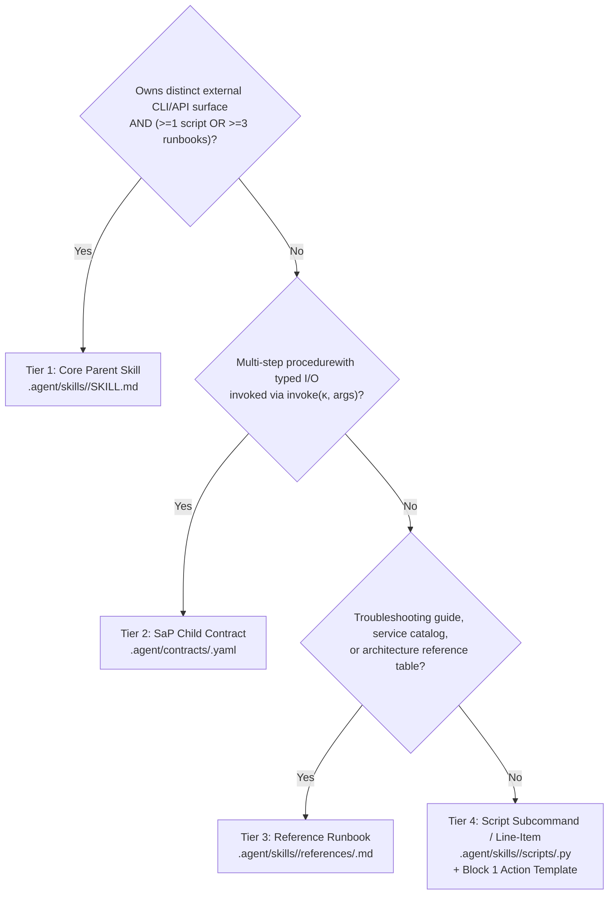

# Skill-as-Pseudocode (SaP) & Agent/Skill Consolidation Architecture

**Reference Paper**: *Skill-as-Pseudocode: Refactoring Skill Libraries to Pseudocode for LLM Agents* (Xinze Li, Yuhang Zang, Yixin Cao, Aixin Sun; arXiv:2605.27955v2)  
**Implementation Package**: [`scripts/sap/`](file:///mnt/d/OneDrive/Email_attachments/Programming-Work/scripts/sap/) | **Verification Suite**: [`tests/test_sap_pipeline.py`](file:///mnt/d/OneDrive/Email_attachments/Programming-Work/tests/test_sap_pipeline.py)

---

## 1. Executive Summary: Why Prose Fails and Pseudocode Wins

Free-form Markdown skill libraries (`SKILL.md`) force LLM agents to re-derive two distinct signals on every retrieval:
1. **What the skill does and requires** (its trigger, input schema, output schema, preconditions, postconditions, and side effects).
2. **How the skill is concretely invoked** (exact CLI flags, environment variables, script entrypoints, and output pipes).

In raw prose, these two signals are interleaved with narrative persona paragraphs (*"You are a Senior Engineer..."*), scattered caveats, and unverified examples. Empirically (Li et al., §1, §6.1), this produces a **"confused $\rightarrow$ re-retrieve $\rightarrow$ still confused" loop**: the agent issues a near-miss command, receives an error or empty output, and re-retrieves the same long prose document.

### The Core Empirical Law of Skill-as-Pseudocode (SaP §5.7, Table 4)

A critical finding of the SaP paper's bundle-component ablation on ALFWorld ($n=134$ games) is that **a typed contract alone performs worse than raw prose**:

| Representation Served After Retrieval | Wins / 134 | Delta vs Raw Prose | Why It Happens |
| :--- | :---: | :---: | :--- |
| **Full SaP Bundle (`Templates + Skeleton + Contracts`)** | **30** | **+87.5%** | Agent reads exact executable syntax first, sees control-flow order in skeleton, and binds typed inputs via contract. |
| **Template-only** (contract block removed) | 25 | +56.3% | Agent has exact CLI syntax, but lacks preconditions/postconditions when adapting to new bindings. |
| **Length-matched raw prose** (same char budget) | 18 | +12.5% | Proves gain is **structural**, not merely brevity/token truncation. |
| **Raw prose baseline (`gos`)** | 16 | 0.0% | Agent suffers "lost-in-the-middle" degradation searching prose for flags and preconditions. |
| **Contract-only** (action templates removed) | **13** | **-18.8%** | Abstract JSON/YAML signature without concrete CLI syntax leaves the agent guessing flag/subcommand names. |

**Mandatory Engineering Takeaway**: Never replace a skill with an abstract schema alone. Every refactored skill and agent in `.agent/` MUST pair **Block 1: Concrete Action Templates** (in the prefix region read first) with **Block 2: Procedural Skeleton (`invoke(κ, bindings)`)** and **Block 3: Inlined Typed Child Contracts (`κ`)**.

---

## 2. Five Key Lessons Learned Implementing SaP as Pseudocode

During the implementation of [`scripts/sap/`](file:///mnt/d/OneDrive/Email_attachments/Programming-Work/scripts/sap/) across this repository, five concrete engineering lessons emerged:

### Lesson 1: Over-Wide Clustering Breaks Coverage Recall (Caught by Non-Circular Verification)
- **What happened**: When we initially grouped 6–7 loosely related skills into single broad contracts (e.g., grouping `skill-aws`, `skill-aws-foundation`, `skill-aws-serverless`, `skill-aws-sagemaker`, `skill-aws-migration`, and `skill-finops` under a trigger listing every service name), our non-circular 4-check verifier ([`scripts/sap/verifier.py`](file:///mnt/d/OneDrive/Email_attachments/Programming-Work/scripts/sap/verifier.py)) **rejected 6 of the 13 contracts** with `coverage_recall < 0.45` (scores `0.24` to `0.42`).
- **Why**: A contract's trigger and I/O schema must reflect the **shared procedural intersection** of its parent units, not the union of parent-specific nouns. If `sagemaker` appears in only 1 of 6 parents, token recall across the other 5 parents collapses.
- **How we fixed it**:
  1. Enforced **non-circular verification** ([`_strip_sap_bundle`](file:///mnt/d/OneDrive/Email_attachments/Programming-Work/scripts/sap/verifier.py#L366-L371)): the verifier strips any injected `<!-- SAP_BUNDLE_START -->` block before computing `coverage` and `binding` against the parent skill text.
  2. Consolidated fragmented sub-skills into their true Core Parent Skill first, and aligned contract triggers/schemas with shared operational tokens.

### Lesson 2: Hierarchical Separation of Child Contracts Prevents Retrieval Pollution (SaP §3.5, §5.6)
- **What happened**: In the pre-refactor repository, 42 sub-procedures (`skill-pr-creator`, `skill-context-master`, `skill-gcp-setup`, `skill-nexus-sync`, `skill-harness-models`, etc.) were exposed as top-level directories in `.agent/skills/`.
- **Why this hurts agents**: SaP §5.6 proves that surfacing child sub-procedures in the top-level retrieval pool drops task reward by **27%** (`30 -> 22` wins). When an agent retrieves a narrow sub-skill without its parent's orchestration context and preconditions, it executes actions out of order.
- **How we fixed it**:
  - Promoted child contracts live exclusively in [`.agent/contracts/*.yaml`](file:///mnt/d/OneDrive/Email_attachments/Programming-Work/.agent/contracts/), indexed under a separate `"contracts"` key in [`.agent/metadata.json`](file:///mnt/d/OneDrive/Email_attachments/Programming-Work/.agent/metadata.json).
  - [`tests/test_sap_pipeline.py`](file:///mnt/d/OneDrive/Email_attachments/Programming-Work/tests/test_sap_pipeline.py#L211-L219) enforces a hard invariant that **zero** contract IDs in `.agent/contracts/` may appear as top-level directories in `.agent/skills/`.

### Lesson 3: Pseudocode Notation Must Explicitly Disambiguate `invoke(...)` from Shell Binaries
- **What happened**: In ALFWorld case studies (SaP Appendix S), agents reading prose skills sometimes emit the skill name itself as a shell command (`use alfworld-object-locator to find mug`).
- **How we fixed it**: Every SaP bundle header in `.agent/skills/*/SKILL.md` and `.agent/agents/*.yaml` includes the explicit guard header from SaP Figure 2:
  > `> **SaP Substituted Bundle**: invoke(...) is structural pseudocode notation in this skill document, not an executable shell binary. Emit the concrete CLI/script commands in Action Templates first.`

### Lesson 4: Rewrite Cleanup (RC) Eliminates Stale Syntax Drift Across Examples
- **What happened**: Legacy skill prose contained commands missing the repository's mandatory `| bin/rtk` terminal proxy or invoking `python3` instead of `/usr/bin/python3` (which is required for system `tree_sitter` bindings in `skill-code-map`).
- **How we fixed it**: Inlined Action Templates in Block 1 standardize on `/usr/bin/python3` for AST scripts and pipe all shell commands through `| bin/rtk`. [`verify_rc_bundle`](file:///mnt/d/OneDrive/Email_attachments/Programming-Work/scripts/sap/refactor.py#L44-L78) deterministically verifies that every refactored skill contains `## 1. Action Templates` with code fences, `## 2. Procedural Skeleton` with `invoke(κ, args)`, and `## 3. Inlined Child Contracts`.

### Lesson 5: Risk Gating Must Be Deterministic and Hard-Rejected Before Promotion
- **What happened**: Soft LLM scores can accidentally promote a snippet containing destructive flags (`rm -rf`, `terraform destroy`, `git push origin main`, `gh pr merge`, `subprocess(..., shell=True)`).
- **How we fixed it**: [`compute_risk`](file:///mnt/d/OneDrive/Email_attachments/Programming-Work/scripts/sap/verifier.py#L97-L115) scans `action_templates` and `resources` against deterministic regex/AST patterns and assigns a hard-reject score ($\ge 0.85 > 0.80$ cutoff) unless the side effect is explicitly declared in `side_effects` AND paired with a `confirm` precondition.

---

## 3. The 4-Tier Taxonomy: What Belongs Where?

When adding or refactoring capabilities in `.agent/`, apply this deterministic 4-tier classification rule:



| Tier | Artifact Path | Qualification Criteria | Examples |
| :--- | :--- | :--- | :--- |
| **1. Core Parent Skill** | `.agent/skills/<name>/SKILL.md` | Owns a major domain toolchain (`kubectl`, `aws`, `gcloud`, `terraform`, `gh`, `tree-sitter`/`ast-grep`) and is bound to $\ge 1$ canonical agent. | `skill-code-map`, `skill-graphify`, `skill-kubernetes`, `skill-aws`, `skill-gcp`, `skill-sre-investigation`, `skill-terraform` |
| **2. SaP Child Contract** | `.agent/contracts/<id>.yaml` | Typed procedural contract ($\kappa$) with verified `trigger`, `input_schema`, `output_schema`, `preconditions`, `postconditions`, `side_effects`, and `action_templates`. | `ast-blast-radius-gate`, `k8s-workload-triage`, `iac-infra-provisioning`, `sre-telemetry-incident-response` |
| **3. Reference Runbook** | `.agent/skills/<parent>/references/*.md` | Deep-dive domain documentation, architecture patterns, or failure-mode tables loaded conditionally on symptom match. | `istio-expert.md`, `PodCrashLoopBackOff.md`, `ddd.md`, `review-suite.md`, `finops.md` |
| **4. Script Subcommand** | `.agent/skills/<parent>/scripts/*` + `Action Templates` | Deterministic CLI execution wrapping 1–3 commands. Exposed as a line-item in Block 1 (`Action Templates`), never as a separate `SKILL.md`. | `./scripts/hydrate.sh models`, `detect_zscore.py`, `verify-cluster.sh`, `gh run list` |

---

## 4. Consolidation Ledger: 55 Skills $\rightarrow$ 13 Core Parent Skills & 15 Agents

Prior to consolidation, an empirical audit of the 55 skills in `.agent/skills/` revealed:
- **22 Orphan Skills (`40%`)**: Bound to **0** canonical agents in `.agent/agents/*.yaml` (including `skill-code-map` and `skill-graphify`!).
- **23 Zero-Asset Prose Stubs (`42%`)**: Contained **0 scripts**, **0 references**, and **0 resources** (e.g., `skill-msbuild` at 18 lines, `skill-finops` at 23 lines, `skill-frontend` at 23 lines).
- **Duplicate SRE Agent**: `sre-specialist.yaml` duplicated `specialist-sre.yaml`.

Using [`scripts/sap/consolidate_skills.py`](file:///mnt/d/OneDrive/Email_attachments/Programming-Work/scripts/sap/consolidate_skills.py), we migrated **87 scripts** and **189 reference runbooks** from the 42 sub-skills into **13 Core Parent Skills** (`-76.4%` reduction in top-level skill noise with **zero asset loss**):

| # | Core Parent Skill | Promoted SaP Contract (`κ`) | Absorbed Sub-Skills (42) | Bundled Scripts | Reference Runbooks | Bound Agents |
| :-: | :--- | :--- | :--- | :---: | :---: | :--- |
| 1 | [`skill-code-map`](file:///mnt/d/OneDrive/Email_attachments/Programming-Work/.agent/skills/skill-code-map/SKILL.md) | [`ast-blast-radius-gate`](file:///mnt/d/OneDrive/Email_attachments/Programming-Work/.agent/contracts/ast-blast-radius-gate.yaml) | `skill-context-master`, `skill-codebase-recon` | 47 | 2 (+30 rules) | `swarm-scout`, `swarm-architect`, `swarm-engineer`, `swarm-auditor`, `security-reviewer`, `specialist-aws`, `specialist-github`, `specialist-terraform`, `db-migration-agent` |
| 2 | [`skill-graphify`](file:///mnt/d/OneDrive/Email_attachments/Programming-Work/.agent/skills/skill-graphify/SKILL.md) | [`k8s-graphify-topology`](file:///mnt/d/OneDrive/Email_attachments/Programming-Work/.agent/contracts/k8s-graphify-topology.yaml) | `skill-crossplane` | 42 | 1 | `swarm-scout`, `swarm-architect`, `security-reviewer`, `specialist-k8s`, `specialist-terraform` |
| 3 | [`skill-kubernetes`](file:///mnt/d/OneDrive/Email_attachments/Programming-Work/.agent/skills/skill-kubernetes/SKILL.md) | [`k8s-workload-triage`](file:///mnt/d/OneDrive/Email_attachments/Programming-Work/.agent/contracts/k8s-workload-triage.yaml) | `skill-kubernetes-local` | 58 | 7 | `specialist-k8s`, `specialist-gcp`, `specialist-sre`, `specialist-terraform` |
| 4 | [`skill-aws`](file:///mnt/d/OneDrive/Email_attachments/Programming-Work/.agent/skills/skill-aws/SKILL.md) | [`aws-cloud-architecture-audit`](file:///mnt/d/OneDrive/Email_attachments/Programming-Work/.agent/contracts/aws-cloud-architecture-audit.yaml) | `skill-aws-foundation`, `skill-aws-serverless`, `skill-aws-sagemaker`, `skill-aws-migration`, `skill-finops` | 1 | 132 | `specialist-aws`, `specialist-terraform` |
| 5 | [`skill-gcp`](file:///mnt/d/OneDrive/Email_attachments/Programming-Work/.agent/skills/skill-gcp/SKILL.md) | [`gcp-cloud-ops-triage`](file:///mnt/d/OneDrive/Email_attachments/Programming-Work/.agent/contracts/gcp-cloud-ops-triage.yaml) | `skill-gcp-setup`, `skill-gcp-mcp-setup`, `skill-gcp-playbooks` | 6 | 17 | `specialist-gcp`, `specialist-sre`, `specialist-terraform` |
| 6 | [`skill-sre-investigation`](file:///mnt/d/OneDrive/Email_attachments/Programming-Work/.agent/skills/skill-sre-investigation/SKILL.md) | [`sre-telemetry-incident-response`](file:///mnt/d/OneDrive/Email_attachments/Programming-Work/.agent/contracts/sre-telemetry-incident-response.yaml) | `skill-sre-advanced`, `skill-sre-governance`, `skill-observability`, `skill-data-ingestion` | 18 | 21 | `specialist-sre`, `specialist-k8s` |
| 7 | [`skill-terraform`](file:///mnt/d/OneDrive/Email_attachments/Programming-Work/.agent/skills/skill-terraform/SKILL.md) | [`iac-infra-provisioning`](file:///mnt/d/OneDrive/Email_attachments/Programming-Work/.agent/contracts/iac-infra-provisioning.yaml) | `skill-packer`, `skill-network`, `skill-certificate-manager`, `skill-on-prem-provisioning` | 1 | 11 | `specialist-terraform`, `specialist-aws`, `swarm-engineer`, `db-migration-agent` |
| 8 | [`skill-github`](file:///mnt/d/OneDrive/Email_attachments/Programming-Work/.agent/skills/skill-github/SKILL.md) | [`github-pr-ci-governance`](file:///mnt/d/OneDrive/Email_attachments/Programming-Work/.agent/contracts/github-pr-ci-governance.yaml) | `skill-pr-creator`, `skill-ci-replicator`, `skill-review-suite`, `skill-docs` | 1 | 12 | `specialist-github`, `swarm-engineer`, `swarm-auditor`, `swarm-supervisor` |
| 9 | [`skill-compliance-auditor`](file:///mnt/d/OneDrive/Email_attachments/Programming-Work/.agent/skills/skill-compliance-auditor/SKILL.md) | [`ast-policy-compliance-audit`](file:///mnt/d/OneDrive/Email_attachments/Programming-Work/.agent/contracts/ast-policy-compliance-audit.yaml) | `skill-behavioral-evals` | 2 | 11 | `security-reviewer`, `swarm-auditor` |
| 10 | [`skill-conductor`](file:///mnt/d/OneDrive/Email_attachments/Programming-Work/.agent/skills/skill-conductor/SKILL.md) | [`conductor-swarm-orchestration`](file:///mnt/d/OneDrive/Email_attachments/Programming-Work/.agent/contracts/conductor-swarm-orchestration.yaml) | `skill-swarm`, `skill-swarm-agents`, `skill-swarm-management`, `skill-ddd`, `skill-architecture`, `skill-product_blueprint` | 4 | 22 | All 15 Canonical Agents |
| 11 | [`skill-factory-compiler`](file:///mnt/d/OneDrive/Email_attachments/Programming-Work/.agent/skills/skill-factory-compiler/SKILL.md) | [`factory-hydration-compiler`](file:///mnt/d/OneDrive/Email_attachments/Programming-Work/.agent/contracts/factory-hydration-compiler.yaml) | `skill-harness-models`, `skill-nexus-sync`, `skill-webhook-autoload`, `skill-agentic-initializer` | 5 | 5 | `swarm-supervisor`, `swarm-auditor`, `specialist-opencode` |
| 12 | [`skill-always-on-memory`](file:///mnt/d/OneDrive/Email_attachments/Programming-Work/.agent/skills/skill-always-on-memory/SKILL.md) | [`cognitive-memory-archivist`](file:///mnt/d/OneDrive/Email_attachments/Programming-Work/.agent/contracts/cognitive-memory-archivist.yaml) | `skill-episodic-memory`, `skill-graph-memory` | 0 (`bin/memory_agent.py`) | 2 | `memory-agent` |
| 13 | [`skill-platform-admin`](file:///mnt/d/OneDrive/Email_attachments/Programming-Work/.agent/skills/skill-platform-admin/SKILL.md) | [`runtime-tooling-platform-ops`](file:///mnt/d/OneDrive/Email_attachments/Programming-Work/.agent/contracts/runtime-tooling-platform-ops.yaml) | `skill-mcp-manager`, `skill-opencode`, `skill-gemini`, `skill-msbuild`, `skill-frontend` | 1 | 11 | `specialist-opencode`, `specialist-gcp` |

### Why `skill-code-map` and `skill-graphify` Are Both Standalone
Both [`skill-code-map`](file:///mnt/d/OneDrive/Email_attachments/Programming-Work/.agent/skills/skill-code-map/SKILL.md) and [`skill-graphify`](file:///mnt/d/OneDrive/Email_attachments/Programming-Work/.agent/skills/skill-graphify/SKILL.md) are retained as independent top-level Core Parent Skills, and their shared graph/catalog/AST scripts (`k8s_graphify_extract.py`, `k8s_catalog.py`, `local_extract.py`, `semantic_query.py`, `auto_context.py`, `graph_builder.py`, `state_graph.py`, `codemap_graphify_mcp.py`, `sgconfig.yml`, and `rules/`) are mirrored into both `scripts/` directories with local-first path resolution (`_LOCAL_DIR = Path(__file__).resolve().parent`). Either skill can operate in 100% standalone isolation without cross-directory `sys.path` breakage.

---

## 5. SaP Compiler & Verifier Pipeline Reference

The deterministic SaP toolchain in [`scripts/sap/`](file:///mnt/d/OneDrive/Email_attachments/Programming-Work/scripts/sap/) runs in five stages:

```bash
# Stage 1: Parse SKILL.md library into procedural units (.cache/sap/parents.json)
.venv/bin/python scripts/sap/parser.py

# Stage 2: Propose candidate clusters via shallow frame tuples + cosine similarity (.cache/sap/clusters.json)
.venv/bin/python scripts/sap/proposer.py

# Stages 3–5: Compile & verify contracts (.agent/contracts/*.yaml), inject SaP bundles, and upgrade agents
PYTHONPATH=. .venv/bin/python scripts/sap/compile_corpus.py

# Hydrate all 3 vendor harnesses (.claude/, .agents/, .codex/) & recompile metadata (.agent/metadata.json)
./scripts/hydrate.sh all
.venv/bin/python bin/compile_metadata.py --repo-root . --output .agent/metadata.json

# Run full Runtime Discovery & SaP Verification Gate + Unit Tests
.venv/bin/python bin/verify_runtime_discovery.py
.venv/bin/python -m unittest tests/test_sap_pipeline.py
```

### The Four Deterministic Verifier Checks ([`scripts/sap/verifier.py`](file:///mnt/d/OneDrive/Email_attachments/Programming-Work/scripts/sap/verifier.py))
1. **Coverage ($w_c = 0.30$, threshold $\ge 0.45$)**: Token recall of $\kappa$'s `trigger`, `input_schema`, and `output_schema` against the un-injected parent text.
2. **Binding ($w_b = 0.40$, threshold $\ge 0.50$)**: Fraction of `(parent, required_input)` pairs where parent text/templates bind the required input slot.
3. **Replacement ($w_r = 0.30$, threshold $\ge 0.80$)**: Verifies valid kebab-case contract ID, non-empty `action_templates`, and balanced Markdown code fences (` ``` `).
4. **Risk ($w_s = 1.00$, hard-reject $\ge 0.80$)**: Regex/AST scan for undeclared destructive sinks (`rm -rf`, `terraform destroy`, `git push <remote> master|main`, `gh pr merge`, `subprocess(..., shell=True)`, `eval()`).
5. **Calibration**: Evaluated against 30 synthetic negative controls (`10 B_same_domain_distinct`, `10 C_near_miss`, `10 D_swapped_contract`) at $(\tau_{\text{auto}}, \tau_{\text{rev}}) = (0.65, 0.35)$ with **0.0% false-positive promotion**.
